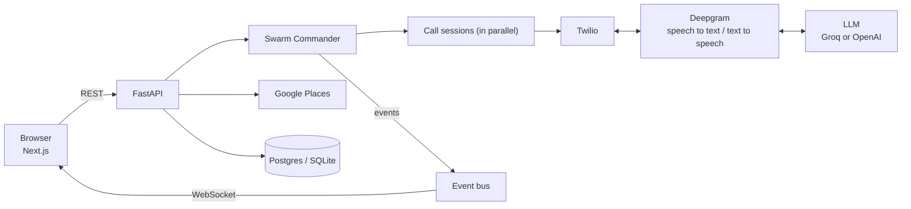

<div align="center">

# Swarm Dial

**Ten phone calls. One minute.**

AI callers phone local businesses all at once, ask what's available right now, and bring back the best answer.


</div>

<!-- Add a screenshot of the landing page here once it is in the repo:
 -->

## The problem

Finding something nearby that is open and actually in stock means calling around: one pharmacy after another, hold music, transfers, hang-ups, the same question asked over and over. When you are stressed, short on time, or not comfortable on the phone, that is a lot to ask.

## What Swarm Dial does

You type what you need in plain English, for example *"find a pharmacy within 5 miles that has children's amoxicillin in stock right now"*, and tap **Use my location**. Swarm Dial finds nearby businesses and sends a swarm of AI callers to phone them **at the same time**.

- **Honest about being a robot.** Every call opens with "I'm an AI assistant calling on behalf of a person nearby." There is deliberately no switch to turn this off.
- **Live dashboard.** Watch who is ringing, who is talking and what each business said, with a full transcript of every call.
- **A Swarm Commander coordinates the calls.** If a business is closed, out of stock or points elsewhere, it reroutes to the next one. It shares what the callers learn and stops early once enough businesses have confirmed.
- **One clear answer.** Results are ranked and the best match is shown at the top, and one click makes a second call to ask the business to hold it.
- **Practice mode.** Try the full experience with simulated businesses and scripted callers, with no API keys and no real calls.
- **Real calls only to places that are open.** Live mode skips closed businesses, never redials the same place within a cooldown, and has a daily call cap.

Swarm Dial also handles food-donation pickups, where a donor describes surplus food and nearby food banks and pantries are called to find who can collect it soonest.

## How it works



Every state change is an event, and the browser draws the dashboard by replaying those events through one reducer. That is why a page reload or reconnect picks up exactly where it left off. For the full picture (database schema, event bus, how a call flows), see [`docs/ARCHITECTURE.md`](docs/ARCHITECTURE.md).

## Tech stack

| Layer | What we used |
|---|---|
| Frontend | Next.js 14 (App Router), React, TypeScript, Tailwind CSS, Framer Motion |
| Backend | FastAPI, Python, SQLAlchemy |
| Voice | Twilio (phone calls), Deepgram (speech-to-text and text-to-speech) |
| AI | Groq Llama 3 or OpenAI GPT-4o-mini, driving each conversation and parsing requests |
| Data | Google Places for businesses, PostgreSQL (Neon) or SQLite for storage, optional Redis |
| Auth | Auth0 |
| Testing | pytest, Vitest |

## Quick start

You need Python 3.11+ and Node 18+.

```bash
make setup        # installs backend (venv) and frontend dependencies
make backend      # terminal 1: API on http://localhost:8000/docs
make frontend     # terminal 2: app on http://localhost:3000
```

Practice mode works straight away, with no keys needed.

| Command | What it does |
|---|---|
| `make mock` | Frontend-only: replays recorded swarms on :8000, no Python needed |
| `make sim` | Watch a full swarm run in the terminal |
| `make test` | Backend tests, frontend tests and type check |
| `make preflight` | Check every key and URL live mode needs, without placing a call |
| `make contract` | Regenerate the shared schema and TypeScript types after editing the backend models |
| `make up` | Run everything in Docker |

## Sign-in (Auth0)

Sign-in runs on [Auth0](https://auth0.com). Create `frontend/.env.local` (it is git-ignored) with your tenant's values:

```bash
AUTH0_DOMAIN=your-tenant.us.auth0.com
AUTH0_CLIENT_ID=...
AUTH0_CLIENT_SECRET=...
AUTH0_SECRET=...        # any long random string, e.g. from: openssl rand -hex 32
APP_BASE_URL=http://localhost:3000
NEXT_PUBLIC_API_URL=http://localhost:8000
```

In your Auth0 application, set:

- **Allowed Callback URLs:** `http://localhost:3000/auth/callback`
- **Allowed Logout URLs:** `http://localhost:3000`

## Real phone calls

1. Copy `backend/.env.example` to `backend/.env`.
2. Fill in your Twilio, Deepgram and Groq or OpenAI keys, plus a `GOOGLE_PLACES_API_KEY`.
3. Expose the backend so Twilio can reach it (`ngrok http 8000`) and set `PUBLIC_BASE_URL` to that address.
4. Run `make preflight` to confirm everything is wired up.

For private testing, set `ALLOW_REAL_BUSINESS_CALLS=false` and list teammates' phones in `DEMO_TARGETS`. Only those numbers will ring.

## Safety and responsible use

- Every call discloses that it is an AI at the start, and calls are transcribed so you can read every word.
- Closed businesses are never called, the same business is not redialed within a cooldown (`REDIAL_COOLDOWN_MIN`), and live calls are capped per day (`MAX_CALLS_PER_DAY`).
- Practice mode uses fictional businesses with 555 numbers.
- Twilio webhooks verify their signature, and media streams require a per-call token.

## Project layout

```
backend/    FastAPI app, Swarm Commander, call agents, Twilio bridge, tests
frontend/   Next.js app: landing page, search, live swarm dashboard, tests
contract/   Shared schema, generated TypeScript types, recorded fixtures
docs/       Architecture notes (database schema, event bus, call flow)
```

The Pydantic models in `backend/app/contract.py` are the single source of truth for the data shared between backend and frontend. Edit them, then run `make contract`.

## Built by

Saamarth Attray and Jaswant Pelluru.